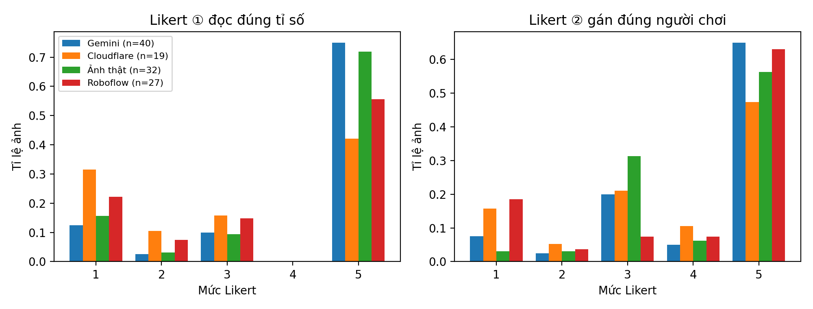
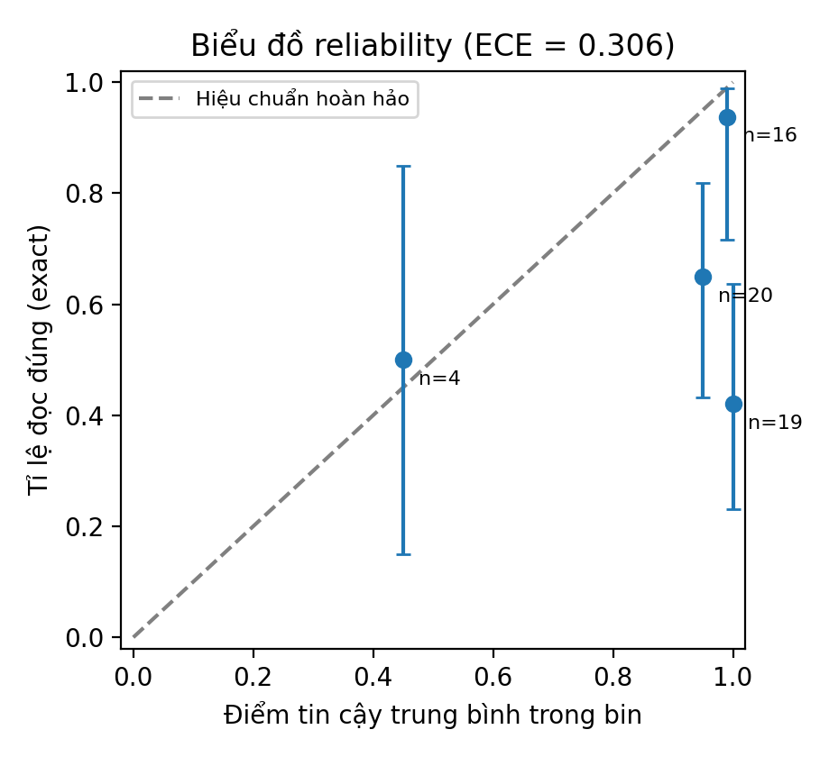
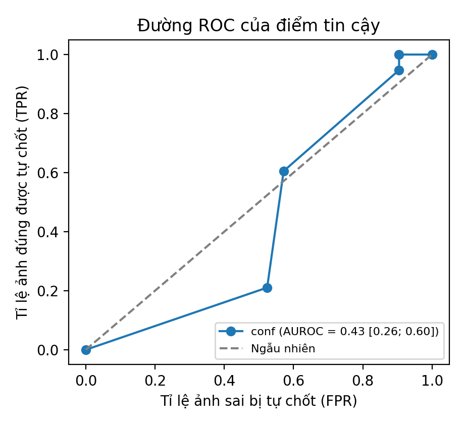
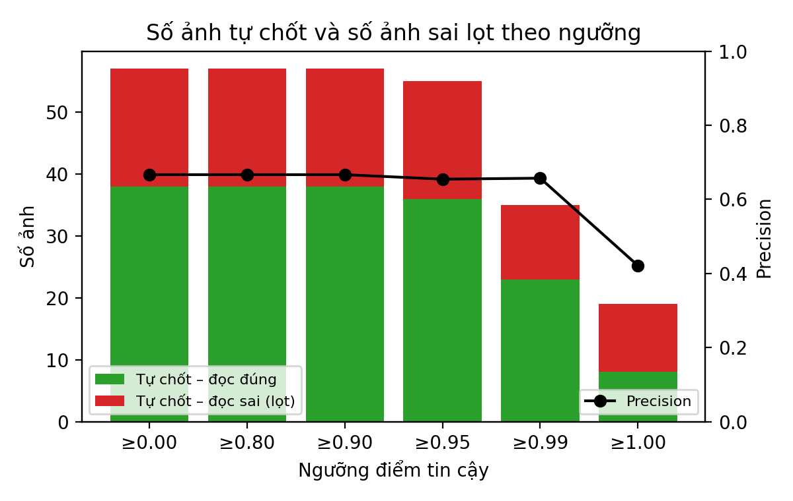

# Báo cáo kết quả thử nghiệm: AI đọc ảnh bảng tỉ số cầu lông (59 mẫu)

Ngày chạy: 09/11/2026. Toàn bộ số liệu sinh ra từ script, không nhập tay:

```bash
PYTHONIOENCODING=utf-8 python ai-notes/eval/paper/analyze.py
```

Output đầy đủ: `ai-notes/eval/paper/ket-qua-analyze.txt`; kết quả từng ảnh: `per-image.json`; hình: `fig/`.
Khoảng tin cậy 95% ghi trong ngoặc vuông: Wilson cho tỉ lệ, bootstrap (10.000 lần, seed 20261109) cho trung bình và AUROC.

## Kết luận chung

**Hiệu quả hệ thống hiện tại: 88,1% [77,5; 94,1] ảnh không bị chốt sai (52/59)** — gồm ảnh đọc đúng được tự chốt ở mức Xanh và ảnh được chuyển sang mức Vàng để người dùng kiểm tra.

| Câu hỏi | Kết quả | Khoảng tin cậy 95% |
|---|---|---|
| AI đọc đúng **toàn bộ** tỉ số của ảnh | **38/59 = 64,4%** | [51,7; 75,4] |
| AI đọc đúng **bên đang dẫn/thắng** | 46/59 = 78,0% | [65,9; 86,6] |
| Ảnh hệ thống xếp mức Xanh (tự chốt) mà **đọc đúng** | **29/36 = 80,6%** | [65,0; 90,2] |
| Ảnh hệ thống **không chốt sai** (đúng ở Xanh, hoặc đã chuyển người dùng kiểm ở Vàng) | **52/59 = 88,1%** | [77,5; 94,1] |
| Ảnh sai mà vẫn bị tự chốt | 7/59 = 11,9% | [5,9; 22,5] |

Diễn giải ngắn: mô hình đọc đúng hoàn toàn khoảng 2/3 số ảnh. Nhờ lớp phân tầng Xanh/Vàng của hệ thống hiện tại, khoảng 88% ảnh không dẫn tới kết quả chốt sai; 7 ảnh sai lọt vào Xanh đều là lỗi **thiếu ván** (bảng hiển thị ván cũ/ván đang đánh) mà không tín hiệu nào hiện có bắt được. Điểm tin cậy của mô hình **không** dùng được để phân biệt đúng/sai (AUROC 0,43, dưới mức ngẫu nhiên 0,5).

> PO chốt (09/11/2026) dùng 88,1% làm con số hiệu quả chính. Các tỉ lệ 64,4% và 80,6% vẫn báo cáo kèm theo, để tách phần đóng góp của riêng mô hình AI và của lớp phân tầng.

## 1. Mẫu đã thu thập

| Bộ | Nguồn | Số ảnh đã chấm | Gemini | Cloudflare |
|---|---|---|---|---|
| Ảnh thật | Internet/Facebook (màn hình TV 27, bảng lật/đời thường 5 trong bộ 32 gốc) | 32 | 22 | 10 |
| Roboflow | Bộ ảnh CC BY 4.0 (khung hình video thi đấu) | 27 | 18 | 9 |
| **Tổng** | | **59** | **40** | **19** |

- Đã chạy 112 ảnh (32 thật + 80 Roboflow); PO chấm 59 ảnh và chỉ giữ 59 ảnh này. Bộ 20 ảnh Muse tổng hợp đã bỏ.
- Tỉ số thật (ground truth) do PO tự nhập bằng mắt.
- Mô hình là kết quả thực tế của chuỗi production: `gemini-3.5-flash-lite` trước, hết hạn mức thì chuyển `llama-4-scout` (Cloudflare). Mô hình không được chọn ngẫu nhiên — ảnh nào rơi vào Cloudflare là do thời điểm hết hạn mức.
- 2 ảnh (frame_255, frame_28) AI không trả kết quả.

## 2. Cách test

1. Mỗi ảnh đưa qua `readScoreImage` (`packages/ai`), lấy các ván AI đọc và điểm tin cậy `minConf` (0–1).
2. Kết quả AI đi qua `mapColumns` (`services/matchmaking-service/src/domain/confidence.ts`) để ghép cột với đội theo tên; đội đăng ký là **giả lập** theo tên in trên ảnh. Hệ thống trả mức Xanh (tự chốt) hoặc Vàng (người khai phải kiểm/chọn cột).
3. PO so kết quả AI với ảnh gốc trên trang chấm, nhập tỉ số thật và chấm 2 thang Likert.
4. Script `analyze.py` so AI với tỉ số thật để tính các chỉ số khách quan; Likert chỉ dùng làm đánh giá chủ quan bổ sung.

Định nghĩa chỉ số:
- **Đúng cấp ảnh**: mọi ván, mọi ô điểm trùng tỉ số thật.
- **Đúng cấp ván / cấp ô**: so theo vị trí; ván thừa/thiếu tính là sai.
- **Đúng bên dẫn/thắng**: bên thắng nhiều ván hơn; bằng số ván thì xét bên dẫn ở ván cuối.

## 3. Thang Likert và kết quả

**Likert ① — AI đọc đúng tỉ số**: 5 đúng hết · 4 đúng nhưng còn phân vân · 3 thiếu/thừa ván · 2 sai một phần chữ số · 1 sai bên thắng hoặc đọc cột thành hàng.

**Likert ② — Gán đúng điểm cho đúng người chơi**: 5 tự động theo tên · 4 theo tên viết tắt · 3 người khai phải chọn cột · 2 đúng một phần · 1 tráo người thắng thành thua.

| Mức | 5 | 4 | 3 | 2 | 1 | Trung bình [CI 95%] | Đạt (≥ 4) |
|---|---|---|---|---|---|---|---|
| Likert ① | 38 | 0 | 7 | 3 | 11 | 3,86 [3,44; 4,27] | 38/59 = 64,4% [51,7; 75,4] |
| Likert ② | 35 | 4 | 12 | 2 | 6 | 4,02 [3,64; 4,34] | 39/59 = 66,1% [53,4; 76,9] |

Nhận xét: phân bố hai cực — hoặc đúng hẳn (mức 5), hoặc sai nặng (mức 1). Likert ① = 5 trùng đúng 38 ảnh exact match. 12 ảnh ở ② = 3 chủ yếu do bảng không in tên hoặc tên viết tắt, hệ thống buộc người khai chọn cột — đây là hành vi an toàn, không phải lỗi.



## 4. Phân tích

### 4.1 Chỉ số khách quan (59 ảnh)

| Chỉ số | Kết quả |
|---|---|
| Đúng cấp ảnh | 38/59 = 64,4% [51,7; 75,4] |
| Đúng cấp ván | 75/100 = 75,0% [65,7; 82,5] |
| Đúng cấp ô điểm | 163/200 = 81,5% [75,5; 86,3] |
| Đúng bên dẫn/thắng | 46/59 = 78,0% [65,9; 86,6] |

### 4.2 So sánh nhóm (cỡ mẫu nhỏ — chỉ mang tính tham khảo)

| | Đúng cấp ảnh | Likert ① TB | Likert ② TB | Kiểm định |
|---|---|---|---|---|
| Gemini (n=40) | 75,0% [59,8; 85,8] | 4,22 | 4,17 | Fisher p = 0,020; OR = 4,12; ① Mann–Whitney p = 0,014, r = 0,34; ② p = 0,196 |
| Cloudflare (n=19) | 42,1% [23,1; 63,7] | 3,11 | 3,68 | |
| Ảnh thật (n=32) | 71,9% [54,6; 84,4] | 4,09 | 4,09 | Fisher p = 0,276; OR = 2,04; ① p = 0,224; ② p = 0,966 |
| Roboflow (n=27) | 55,6% [37,3; 72,4] | 3,59 | 3,93 | |

- Gemini tốt hơn Cloudflare rõ rệt (chênh 32,9 điểm %). Cloudflare là nhánh dự phòng nên đây là điểm yếu khi hết hạn mức Gemini.
- Ảnh thật và Roboflow không khác biệt có ý nghĩa thống kê.
- Chưa hiệu chỉnh đa so sánh; mô hình và bộ ảnh đan chéo nhau (Gemini/Cloudflare: 22/10 ở ảnh thật, 18/9 ở Roboflow).

### 4.3 Điểm tin cậy của mô hình có tách được đúng/sai không? — Không

- Phân bố conf: 0,90 (2 ảnh), 0,95 (20), 0,99 (16), 1,00 (19), không trả (2). Mô hình gần như luôn tự tin.
- **AUROC = 0,43 [0,26; 0,60]** (59 ảnh, ảnh không trả coi conf = 0); 0,37 [0,21; 0,53] nếu chỉ xét 57 ảnh có kết quả. Không cao hơn đoán ngẫu nhiên.
- **ECE = 0,306**: ở mức conf = 1,00 chỉ 42,1% ảnh đúng.
- Theo định nghĩa cũ của `stats-59.py` (sai = Likert ① ≤ 2): conf TB ca đúng 0,97 [0,96; 0,98], ca sai 0,98 [0,97; 0,99] — ca sai còn tự tin hơn.

| Ngưỡng tự chốt | Số ảnh tự chốt | Ảnh sai lọt (exact) | Precision | Ảnh sai lọt (Likert ① ≤ 2) |
|---|---|---|---|---|
| ≥ 0,80 | 57 | 19 | 66,7% [53,7; 77,5] | 13 |
| ≥ 0,90 | 57 | 19 | 66,7% | 13 |
| ≥ 0,95 | 55 | 19 | 65,5% [52,3; 76,6] | 13 |
| ≥ 0,99 | 35 | 12 | 65,7% [49,2; 79,2] | 8 |
| = 1,00 | 19 | 11 | 42,1% [23,1; 63,7] | 8 |

Nâng ngưỡng không làm precision tăng.







### 4.4 Phân tầng nhiều tín hiệu (phân tích hậu kiểm, cùng tập dữ liệu — có nguy cơ overfit)

Quy tắc thử (không dùng tỉ số thật để quyết định):
- **Xanh**: conf ≥ 0,95 **và** ghép cột tự động theo tên **và** mọi ván hợp lệ theo luật (21 điểm, cách 2, chạm 30; ván cuối được phép đang đánh) **và** không có ván 0-0.
- **Đỏ**: AI không trả kết quả, hoặc vi phạm luật khi conf < 0,95. Còn lại **Vàng**.

| Cách phân tầng | Xanh | Đúng trong Xanh | Sai lọt vào Xanh |
|---|---|---|---|
| Chỉ conf ≥ 0,95 | 55 | 65,5% | 19 |
| Hệ thống hiện tại (green) | 36 | 80,6% [65,0; 90,2] | 7 |
| Thử nhiều tín hiệu | 33 | 78,8% [62,2; 89,3] | 7 |

Hai tín hiệu luật cầu lông và ván 0-0 **không** bắt thêm ca sai nào so với hệ thống hiện tại: cùng 7 ảnh lọt (real04, real08, real21, frame2_105, frame2_42, frame_116, Aadya_100), trong đó 6 ảnh là thiếu ván — tỉ số AI đọc vẫn hợp lệ về luật. Muốn bắt lỗi này cần tín hiệu khác (ví dụ đội còn lại xác nhận, đối chiếu số ván với thời lượng/trạng thái trận).

### 4.5 Độ tin cậy của nhãn

- Nhãn Claude đọc bằng mắt trùng tỉ số PO nhập ở 55/59 = 93,2% [83,8; 97,3] (khác ở real02, real19, real28, frame2_42).
- Trên biến AI đúng/sai: đồng thuận 0,983; **Cohen's kappa = 0,963** [0,879; 1,000].
- Chỉ có **một người chấm** (PO); Claude không phải người chấm độc lập thứ hai, nên kappa này chỉ để tham khảo.

### 4.6 Phân loại lỗi (21 ảnh sai)

Phân loại tự động theo cấu trúc (so AI với tỉ số thật):

| Kiểu lỗi | Số ảnh | % trên 59 | Sai bên thắng | Ảnh |
|---|---|---|---|---|
| Sai chữ số / ô điểm | 9 | 15,3% | 6 | real12, real19, real23, frame2_42, frame1_160, frame1_42, frame1_36, frame1_17, frame1_1 |
| Thiếu ván | 6 | 10,2% | 2 | real04, real08, real21, frame2_105, frame_116, Aadya_100 |
| Đọc cột thành hàng | 3 | 5,1% | 3 | real09, real26, frame_134 |
| Không đọc được | 2 | 3,4% | 2 | frame_255, frame_28 |
| Thừa ván (0-0) | 1 | 1,7% | 0 | real28 |

Đối chiếu báo cáo kiểu lỗi trước đó (PO tổng hợp thủ công): nhóm "sai chữ số" của bảng trên gộp hai kiểu mà báo cáo tách riêng — "đọc cột số ván thắng như một ván" (frame1_160, frame1_42, frame1_36, frame1_17) và "sai chữ số đơn lẻ" (real12, real19, frame2_42). Báo cáo thủ công xếp frame1_1 vào "đọc cột thành hàng".

## 5. Hạn chế

- Cỡ mẫu nhỏ (59), khoảng tin cậy rộng (độ chính xác cấp ảnh dao động 52–75%). Mẫu do PO chọn để chấm, không lấy ngẫu nhiên.
- Một người chấm duy nhất; chưa có người chấm độc lập thứ hai.
- Mô hình không được gán ngẫu nhiên cho ảnh; so sánh Gemini/Cloudflare có thể lẫn yếu tố ảnh.
- Đội đăng ký trong ghép cột là giả lập theo tên trên ảnh, chưa phải dữ liệu đăng ký thật.
- Ảnh internet không có EXIF; chưa kiểm tín hiệu chống ảnh cũ/ảnh sửa.
- **Phần RAG và luồng tranh chấp chưa được đo** — không có số liệu, không suy diễn.
- Bộ phân tầng ở mục 4.4 được thiết kế sau khi đã thấy dữ liệu; cần kiểm lại trên tập ảnh mới.
